<picture>
  <source media="(prefers-color-scheme: dark)" srcset="./banner-dark.svg" />
  
</picture>

 
 

<picture>
  <source media="(prefers-color-scheme: dark)" srcset="https://go-skill-icons.vercel.app/api/icons?i=ts,vue,nuxtjs,react,tailwind,nodejs,hono,graphql,aws&theme=dark&perline=9" />
  
</picture>
 
<picture>
  <source media="(prefers-color-scheme: dark)" srcset="https://go-skill-icons.vercel.app/api/icons?i=dynamodb,postgres,redis,terraform,docker,githubactions,vitest,jest&theme=dark&perline=9" />
  
</picture>

 
 

<picture>
  <source media="(prefers-color-scheme: dark)" srcset="./profile/stats-dark.svg" />
  
</picture>
<picture>
  <source media="(prefers-color-scheme: dark)" srcset="./profile/top-langs-dark.svg" />
  
</picture>

 
 

